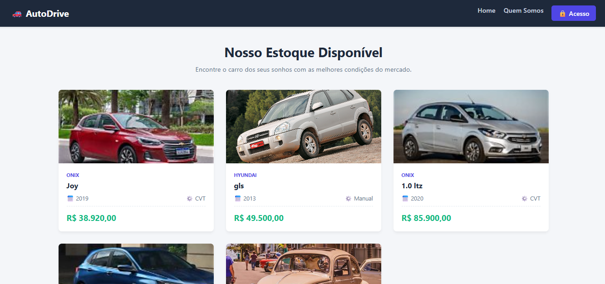
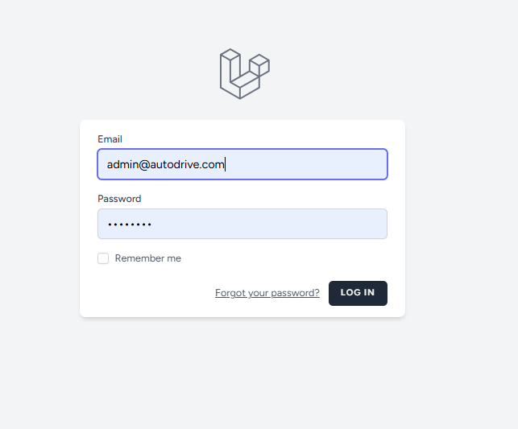
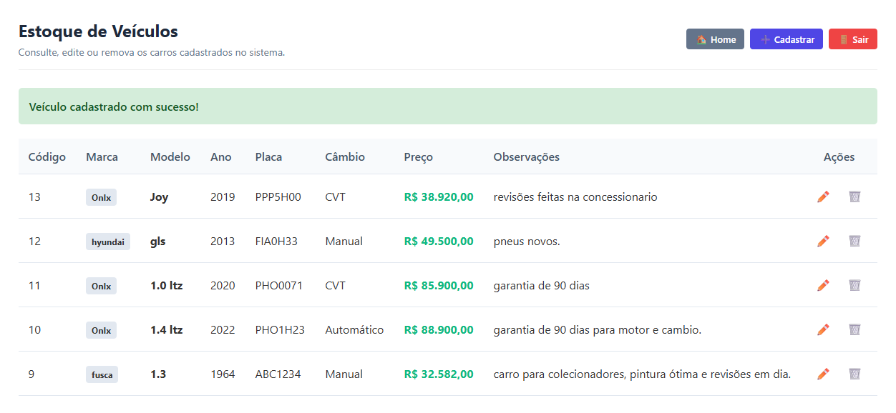
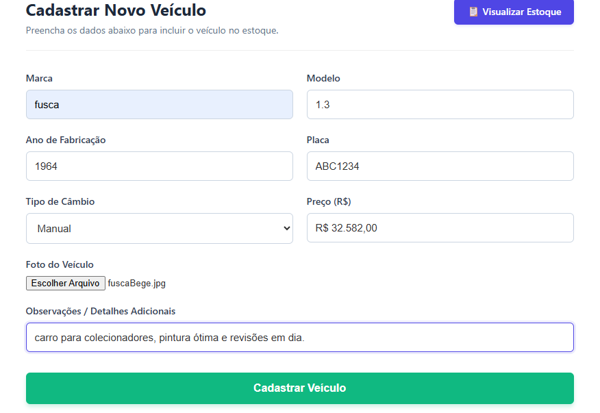
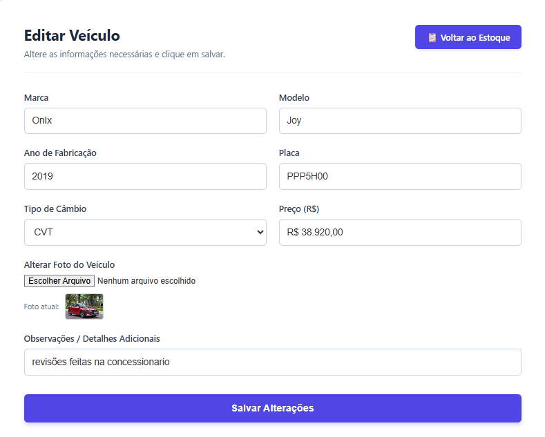

# 🚗 AutoDrive - Sistema de Gerenciamento de Veículos

O **AutoDrive** é um sistema para gerenciamento de estoque de veículos migrado do PHP Nativo para o **Laravel 11**, focado em escalabilidade, segurança e boas práticas de engenharia de software.

---

## 🛠️ Tecnologias Principais

* **Backend:** PHP 8.2+, Laravel 11, Eloquent ORM, MySQL.
* **Frontend (Desenvolvido com auxílio de I.A.):** Blade View Engine, Tailwind CSS, JavaScript (Vanilla) para manipulação de DOM e lógica em tempo real.

---

## 🛡️ Destaques de Arquitetura e Boas Práticas

* **Route Model Binding:** Uso nativo de resolução de instâncias e tratamento automático de erros 404 nas rotas.
* **Form Requests Dedicados:** Classes de validação isoladas (`StoreVehicleRequest` e `UpdateVehicleRequest`).
* **Eloquent Accessors (Laravel 11):** Formatação automática de dados monetários (`preco_formatted`) vindo do banco através do encapsulamento na Model.
* **Máscaras em Vanilla JS:** Componente leve de formatação monetária (Moeda R\$) em tempo real na digitação, sem dependências de bibliotecas externas (jQuery).
* **Zelo de Armazenamento:** Exclusão automática de imagens órfãs e substituição de arquivos físicos no servidor ao remover ou atualizar registros.
* **Tipagem Estrita:** Assinaturas tipadas nos métodos e retornos de todas as Controllers.
* **Versionamento Semântico:** Histórico de Git estruturado baseado em *Conventional Commits*.

---

## 💻 Como Executar Localmente (se preferir pode ver - Demonstração Online - fica logo abaixo.)

1. **Clone o repositório:**
   ```bash
   git clone https://github.com
   cd autodrive-laravel
   ```
2. **Instale as dependências:**
   ```bash
   composer install
   ```
3. **Configure o ambiente:** Copie o `.env.example` para `.env` e configure seu banco de dados MySQL.
4. **Gere a chave e execute as migrações:**
   ```bash
   php artisan key:generate
   php artisan migrate
   ```
5. **Inicie o servidor:**
   ```bash
   php artisan serve
   ```
   Acesse em [http://127.0.0.1:8000](http://127.0.0.1:8000).

---

---  
  
    
## 🌐 Demonstração Online (Acesso para Recrutadores)

O sistema está hospedado e rodando ao vivo na plataforma **Render**! Você pode acessar e testar todas as funcionalidades sem precisar instalar nada localmente.

🔗 **Link do Projeto:** [https://autodrive-laravel-app.onrender.com/](https://autodrive-laravel-app.onrender.com/)

### 🔑 Credenciais de Teste:
Para facilitar a sua avaliação, utilize o usuário padrão abaixo para entrar no sistema:
* **E-mail:** admin@autodrive.com
* **Senha:** senha123
---

## 📸 Capturas de Tela (Screenshots)

<div align="center">
  <h3>Tela Home (Antes de Acessar)</h3>
  

  <h3>Tela de Login / Dados de Acesso</h3>
  
  
  <h3>Tela Home (Depois de Acessar)</h3>
  

  <h3>Dashboard / Estoque de Veículos</h3>
  
  
  <h3>Cadastro de Novo Carro</h3>
  

  <h3>Edição de Carro</h3>
  
</div>


## 📩 Contato
* **Desenvolvedor:** Pablo Leite de Lima
* **GitHub:**   (https://github.com/PabloLeiteDeLima)
* **LinkedIn:** (https://www.linkedin.com/in/pablo-leite-de-lima-254147249/)  
       
       *** Aceito dicas e sujestões ***